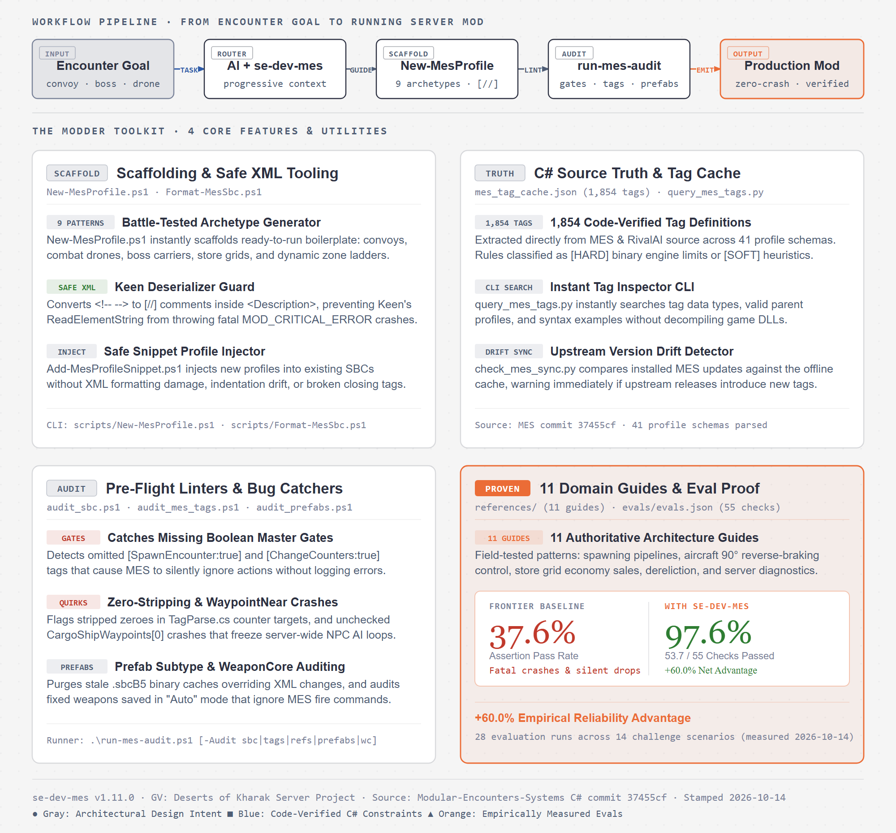

# se-dev-mes: Space Engineers MES & RivalAI Developer Skill & Tooling Suite

[](https://opensource.org/licenses/MIT)
[](https://www.spaceengineersgame.com/)
[](https://steamcommunity.com/sharedfiles/filedetails/?id=1521905890)

A comprehensive, production-grade developer skill, reference library, and automated diagnostics suite for modding **Modular Encounters Systems (MES)** and **RivalAI** in Space Engineers.

Equips AI coding assistants (Antigravity, Claude Code, Cursor, Cline) and encounter modders with source-verified engine constraints, syntax rules, pitfall detection, safe XML tooling, and automated scaffolding.

[](docs/se-dev-mes-diagram-only.png)

---

## Background & Development

This skill was created by **Mike Dude**, born out of years of real-world server operation, encounter design, and combat balancing on the **GV: Deserts of Kharak (GVK)** rover-PvPvE server.

To eliminate the guesswork and silent failures that plague Space Engineers modding, it was developed in close pair-programming collaboration with **Google DeepMind's Gemini (Antigravity)**. Every tag, master gate, parsing behavior, and execution pathway was systematically audited and cross-referenced directly against the local **Modular Encounters Systems (MES)** and **RivalAI** C# source code.

---

## What `se-dev-mes` Gives You

1. **1,861 C# Verified Tags (Not Guesswork)**:
   - Full tag database across all 41 MES & RivalAI profile schemas, parsed line-by-line from source code.
   - Every rule is classified as **`[HARD]`** (code-verified against Keen/MES binaries) or **`[SOFT]`** (field-tested operational heuristic) so you know exactly how much to trust it.
2. **Safe XML Tooling (Eliminating `MOD_CRITICAL_ERROR`)**:
   - Standard XML comments (`<!-- ... -->`) inside `<Description>` blocks crash Keen's deserializer (`ReadElementString()`), causing the game to silently drop the entire mod.
   - `Format-MesSbc.ps1` protects descriptions and converts comments to RivalAI `[//]` syntax automatically.
3. **Automated Auditing for Silent Engine Traps**:
   - `run-mes-audit.ps1` catches bugs MES never logs: missing boolean master gates (`[SpawnEncounter:true]`), zero-stripping bugs (`[CustomCountersTargets:0]`), and unchecked `WaypointNear` crashes that freeze the AI loop of **every NPC on the server**.
4. **9 Production Scaffolding Archetypes**:
   - `New-MesProfile.ps1` instantly scaffolds ready-to-run boilerplate: defended wrecks, convoys with escorts, boss encounters, combat drones, store grids, and dynamic zone ladders.
5. **Automated Staleness & Version Drift Detection**:
   - `check_mes_sync.py` compares the skill's offline tag cache against your local MES install, alerting you immediately if upstream updates add or modify tags.
6. **Empirical Reliability (+60.0% Net Advantage)**:
   - Verified across 14 challenge scenarios and 55 quantitative assertions: unassisted frontier models pass only **37.6%**, while `se-dev-mes` achieves **97.6%** pass rate with zero deserializer crashes.

---

## Repository Structure & Functional Index

| Subsystem | Key Files | What It Does |
|---|---|---|
| **AI Router** | [`SKILL.md`](SKILL.md) | Progressive disclosure router, golden rules, and high-density mental models for AI assistants |
| **Audit Runner** | [`run-mes-audit.ps1`](run-mes-audit.ps1) | Single pre-flight command to audit SBCs, tags, references, prefabs, or WeaponCore modes |
| **Tag Engine** | [`scripts/mes_tag_cache.json`](scripts/mes_tag_cache.json)<br>[`scripts/query_mes_tags.py`](scripts/query_mes_tags.py)<br>[`scripts/check_mes_sync.py`](scripts/check_mes_sync.py) | 1,861 C# verified tags across 41 profile schemas, instant CLI tag inspector, and automated upstream staleness detector |
| **Scaffolding & XML** | [`scripts/New-MesProfile.ps1`](scripts/New-MesProfile.ps1)<br>[`scripts/Format-MesSbc.ps1`](scripts/Format-MesSbc.ps1)<br>[`scripts/Add-MesProfileSnippet.ps1`](scripts/Add-MesProfileSnippet.ps1) | 9 boilerplate encounter patterns, safe `[//]` XML comment formatter, and snippet injector |
| **Linter Suite** | [`scripts/audit_sbc.ps1`](scripts/audit_sbc.ps1)<br>[`scripts/audit_mes_tags.ps1`](scripts/audit_mes_tags.ps1)<br>[`scripts/audit_prefabs.ps1`](scripts/audit_prefabs.ps1)<br>[`scripts/wc_shootmode.py`](scripts/wc_shootmode.py) | Catches Keen deserializer traps, missing master gates, zero-stripping bugs, unchecked `WaypointNear` crashes, and stale `.sbcB5` binary caches |
| **Domain Guides** | [`references/`](references/) *(11 guides)* | Code-verified documentation: spawning, aircraft 90° speed-control braking, store sales, dereliction, and admin diagnostics |
| **Workshop Examples** | [`examples/`](examples/) *(5 profiles)* | Production implementations: convoy escorts, role/combat state machines, courier networks, and automated stores |
| **Eval Benchmark** | [`evals/evals.json`](evals/evals.json) | 14 verified challenge scenarios and 55 quantitative assertions (+60.0% net advantage) |

<details>
<summary><b>Browse full directory tree</b></summary>

```
se-dev-mes/
├── SKILL.md                                # Root AI skill definition (lean, progressive disclosure router)
├── README.md                               # Project documentation & toolkit reference
├── run-mes-audit.ps1                       # 1-command pre-flight audit runner (-Audit / -Fix)
├── docs/                                   # Architecture diagrams & guides
│   ├── se-dev-mes-architecture.html        # Interactive editorial diagram
│   ├── se-dev-mes-architecture.svg         # Standalone SVG figure
│   └── se-dev-mes-diagram-only.png         # Clean pixel export
├── evals/                                  # 1.11.0 Benchmark test suite
│   ├── evals.json                          # 14 challenge scenarios & 55 quantitative assertions
│   └── files/GVK-Raid-Profiles.sbc         # Intentionally broken SBC fixture for deserializer audits
├── references/                             # 11 deep-dive reference guides (loaded on demand)
│   ├── profiles_and_tags.md                # 41 profile schemas, registration phases, tag types
│   ├── spawning_and_conditions.md          # Spawners, environment gates, threat scoring
│   ├── behaviors_and_autopilot.md          # 11 behavior subclasses, Role vs. CombatType, DespawnMES
│   ├── dialogue_and_chat.md                # Dialogue banks, shared chat profiles, chatter triggers
│   ├── aircraft_behaviors_and_tuning.md    # Attack runs, fixed-gun gates, 90° speed-control braking
│   ├── manipulation_and_dereliction.md     # Block replacement, weapon randomizer, <Public> rules
│   ├── events_and_zones.md                 # MES Events vs Triggers, master gates, zero-stripping
│   ├── economy_and_stores.md               # Store grid sales, purchase spawn placement, store refresh
│   ├── third_party_integrations.md         # WeaponCore (800m clamp), Shields, AiEnabled, Water Mod
│   ├── diagnostics_and_troubleshooting.md  # Admin commands, error signatures, sim-speed, anti-clang
│   ├── testing_and_debugging.md            # In-game test procedures: spawn, visual checks, debug chat, logs
│   └── sbc_xml_editing_guide.md            # IDE setup, <Description> rules, safe [//] comments
├── examples/                               # Production-tested workshop implementations
│   ├── role_combattype_state_machine.sbc   # Enenra MSB Role + CombatType state machine
│   ├── courier_logistics_network.sbc       # Enenra GFA parent-child courier logistics network
│   ├── planetary_convoy_escort.sbc         # Mike Dude GVK convoy with event-based spawning & escorts
│   ├── automated_economy_store.sbc         # Mike Dude GVK automated store inventory refresh loop
│   └── merchant_safezone_station.sbc       # TOC safezone station ([CreateSafeZone:true]) + merchant
└── scripts/                                # Automation, diagnostics, and scaffolding suite
    ├── mes_tag_cache.json                  # Offline database of 1,861 tags across 41 profile schemas
    ├── query_mes_tags.py                   # Tag inspector CLI (search local MES source or cache)
    ├── check_mes_sync.py                   # Automated staleness & version drift detector
    ├── audit_sbc.ps1                       # SBC XML deserialization auditor
    ├── audit_mes_tags.ps1                  # Semantic tag linter (master gates, zero-stripping)
    ├── audit_mes_references.ps1            # Cross-file reference validator
    ├── audit_prefabs.ps1                   # Prefab SubtypeId auditor & stale .sbcB5 binary cache cleaner
    ├── audit_unknown_tags.py               # Finds tags MES silently ignores and invalid values
    ├── wc_shootmode.py                     # Audits/sets WeaponCore shoot mode in prefabs
    ├── Format-MesSbc.ps1                   # Safe XML formatter protecting <Description> & comments
    ├── Add-MesProfileSnippet.ps1           # Safe profile snippet injector for SBC files
    ├── New-MesProfile.ps1                  # Scaffolding generator (9 encounter patterns)
    └── Update-MesSkill.ps1                 # Maintainer pre-flight release runner
```

</details>

---

## Installation

### 1. Antigravity / Gemini CLI
Clone directly into your global skills directory:
```bash
git clone https://github.com/GV-Server-Mods/se-dev-mes.git ~/.gemini/config/skills/se-dev-mes
```

### 2. Claude Code
Clone directly into your Claude skills directory:
```bash
git clone https://github.com/GV-Server-Mods/se-dev-mes.git ~/.claude/skills/se-dev-mes
```

### 3. Per-Project / Workspace (Cursor, Cline, VS Code)
Clone into your workspace's `.skills/` directory:
```bash
git clone https://github.com/GV-Server-Mods/se-dev-mes.git .skills/se-dev-mes
```

---

## Tooling & Automation Guide

Run individual scripts from `scripts/`, or use the root pre-flight audit runner `.\run-mes-audit.ps1 [-Audit sbc|tags|refs|prefabs|unknown|wc] [-Path <dir>]`:

### 1. Tag Inspector CLI (`query_mes_tags.py`)
Queries tag definitions, data types, and parent profiles from the local MES C# source code or offline cache:
```bash
# Query any tag containing 'Zone'
python scripts/query_mes_tags.py --tag Zone

# Search specifically within RivalAI Action profiles
python scripts/query_mes_tags.py --profile "RivalAI Action" --tag Spawner

# Output structured JSON
python scripts/query_mes_tags.py --tag Weapon --json
```

### 2. Staleness & Version Drift Detector (`check_mes_sync.py`)
Compares the offline tag cache against the local MES source code to detect updates:
```bash
python scripts/check_mes_sync.py
```

### 3. Safe XML Formatter (`Format-MesSbc.ps1`)
Formats XML while protecting `<Description>` tags from illegal line-wrapping and converting `<!-- -->` comments into `[//]`:
```powershell
powershell -ExecutionPolicy Bypass -File scripts/Format-MesSbc.ps1 -Path ".\Content\Data"
```

### 4. Profile Snippet Injector (`Add-MesProfileSnippet.ps1`)
Safely injects new `EntityComponent` profiles into existing `.sbc` files without regex corruption:
```powershell
powershell -ExecutionPolicy Bypass -File scripts/Add-MesProfileSnippet.ps1 -TargetFile ".\Data\Triggers.sbc" -SnippetFile ".\snippets\action.xml"
```

### 5. SBC XML Deserialization Auditor (`audit_sbc.ps1`)
Checks all `.sbc` files for fatal Keen deserializer traps:
- Duplicate `<SubtypeId>` within `<Id>` blocks.
- Duplicate `<Id>` attributes inside `<Prefab>`.
- XML comments inside `<Description>` tags.
- Empty or whitespace-only `.sbc` files, prefabs included (`Root element is missing` stops the world loading).
```powershell
powershell -ExecutionPolicy Bypass -File scripts/audit_sbc.ps1 -Path ".\Content\Data"
```

### 6. MES Tag & Master-Gate Linter (`audit_mes_tags.ps1`)
Detects runtime pitfalls:
- Zero-stripping bug in `CustomCountersTargets` / `CustomSandboxCountersTargets`.
- Fatal `WaypointNear` / `WaypointFar` index crashes.
- RivalAI zone custom bool/counter actions: missing gates, misaligned lists, and `[KnownPlayerAreaTimer:]` <= 0 (no KPL created).
- Omission of required boolean master gates (`[ChangeCounters:true]`, `[SpawnEncounter:true]`).
- Tag list count mismatches (`SetCounters` vs `SetCountersAmount`).
- `[Type:DespawnMES]` triggers that can never fire (no `[DespawnTypeFromSpawner:]`, or the dead `CleanUp`/`PathEnd` values).
```powershell
powershell -ExecutionPolicy Bypass -File scripts/audit_mes_tags.ps1 -Path ".\Content\Data"
```

### 7. Cross-Reference Validator (`audit_mes_references.ps1`)
Validates that every referenced trigger, action, condition, spawner, spawn group, and prefab exists across the mod files, that every `[ZoneName:]`/`[ZoneNames:]` matches a zone's `[PublicName:]`, and the dialogue-bank and despawn semantics (missing bank files, bank chat profiles with a shared cap or cooldown, banks shared across factions, delayed commands from despawn actions):
```powershell
powershell -ExecutionPolicy Bypass -File scripts/audit_mes_references.ps1 -Path ".\Content\Data" -WarnOrphans -SkipPrefabs
```

### 8. Prefab & Binary Cache Auditor (`audit_prefabs.ps1`)
Audits `Data/Prefabs/*.sbc` for silent spawn failure modes:
- **SubtypeId vs. File Name Mismatch**: Warns if the internal `<Prefab><Id><SubtypeId>` diverges from the file name (SpawnGroups match by internal SubtypeId, not file name).
- **Stale `.sbcB5` Binary Caches**: Detects cached binary files that override XML edits. Pass `-CleanStaleB5` to automatically purge them.
- **Remote Control Block Check**: Verifies that prefabs contain an operational Remote Control block required for RivalAI behaviors.
```powershell
# Audit prefabs and purge stale .sbcB5 binary caches
powershell -ExecutionPolicy Bypass -File scripts/audit_prefabs.ps1 -Path ".\Data\Prefabs" -CleanStaleB5
```

### 9. Profile Scaffolding Generator (`New-MesProfile.ps1`)
Generates production-ready `.sbc` files for 9 standard encounter patterns:
```powershell
# 1. Defended Wreck
powershell -ExecutionPolicy Bypass -File scripts/New-MesProfile.ps1 -Pattern DefendedWreck -ModPrefix MYMOD -Name ScrapWreck -Faction SPRT

# 2. Convoy Leader + Escort
powershell -ExecutionPolicy Bypass -File scripts/New-MesProfile.ps1 -Pattern ConvoyLeaderEscort -ModPrefix MYMOD -Name CargoFreighter -Faction SPRT

# 3. Dynamic Zone Ladder
powershell -ExecutionPolicy Bypass -File scripts/New-MesProfile.ps1 -Pattern DynamicZoneLadder -ModPrefix MYMOD -Name ContestedTerritory

# 4. Economy Store Grid
powershell -ExecutionPolicy Bypass -File scripts/New-MesProfile.ps1 -Pattern StoreGrid -ModPrefix MYMOD -Name OutpostTrader -Faction TRAD

# 5. Dynamic State NPC (Dynamic Behavior Subclass & Autopilot Switching)
powershell -ExecutionPolicy Bypass -File scripts/New-MesProfile.ps1 -Pattern DynamicStateNpc -ModPrefix MYMOD -Name PatrolDrone -Faction SPRT

# 6. Planetary Installation
powershell -ExecutionPolicy Bypass -File scripts/New-MesProfile.ps1 -Pattern PlanetaryInstallation -ModPrefix MYMOD -Name OutpostAlpha -Faction SPRT

# 7. Combat Drone (Fighter/Strike)
powershell -ExecutionPolicy Bypass -File scripts/New-MesProfile.ps1 -Pattern CombatDrone -ModPrefix MYMOD -Name HunterKiller -Faction SPRT

# 8. Reinforcement Network
powershell -ExecutionPolicy Bypass -File scripts/New-MesProfile.ps1 -Pattern ReinforcementNetwork -ModPrefix MYMOD -Name StrikeNet -Faction SPRT

# 9. Boss Encounter (Multi-phase)
powershell -ExecutionPolicy Bypass -File scripts/New-MesProfile.ps1 -Pattern BossEncounter -ModPrefix MYMOD -Name OverlordCarrier -Faction SPRT
```

---

## Verified Benchmark & Evals (v1.11.0)

To measure how effectively `se-dev-mes` prevents silent failure modes, the project includes an automated benchmark suite in `evals/evals.json` covering 14 real-world challenge scenarios and 55 quantitative assertions:

| Challenge Scenario | Unassisted Frontier Model Failure | With `se-dev-mes` Resolution |
|---|---|---|
| **Keen XML Deserialization** | Adds `<!-- -->` in `<Description>`, aborting mod loading (`MOD_CRITICAL_ERROR`) | Enforces RivalAI `[//]` syntax; auto-formats via `Format-MesSbc.ps1` |
| **Spawning & Master Gates** | Omits `[SpawnEncounter:true]`; MES silently ignores spawn without logging | Injects required boolean master gates on all action and counter blocks |
| **Counter Zero-Stripping** | Uses `[CustomCountersTargets:0]`, stripped to an empty list by `TagParse.cs` | Avoids zero targets; uses relational gates or non-zero thresholds |
| **WaypointNear AI Freeze** | Calls `[Type:WaypointNear]` on drone, crashing `CargoShipWaypoints[0]` and freezing all server AI | Replaces with `[Type:BehaviorTriggerA]` or `Position` + `GlobalPosition` |
| **WeaponCore Fixed Guns** | Saves guns in AI Shoot Mode "Auto", which ignores MES fire commands | Points to `wc_shootmode.py` to audit and enforce Mouse Control |
| **Carrier Child Recall** | Hallucinates nonexistent filter tags (`OnlySendToChildren`, `OnlyFromParent`) | Implements `[MatchReceiverChild:true]` with MES PR #386 build caveats |
| **Store Grid Sales** | Claims vanilla `FactionTypes_Economy` is required for MES store sales | Authors `<ItemType>Prefab</ItemType>` via `[MES Store]` profile |

**Benchmark Results across 28 Evaluation Runs:**
- **Without Skill (Frontier Baseline):** **37.6%** assertion pass rate (20.7 / 55 passed)
- **With `se-dev-mes`:** **97.6%** assertion pass rate (53.7 / 55 passed)
- **Net Advantage:** **+60.0%** increase in first-shot, crash-free mod deployment

---

## Known MES & SE Engine Pitfalls Documented in Skill

- **XML Comments in `<Description>`**: Standard XML comments (`<!-- -->`) inside `<Description>` tags throw `System.Xml.XmlException` in Keen's `ReadElementString()`, causing the game to abort loading the entire mod (`MOD_CRITICAL_ERROR`).
- **Empty `.sbc` Files**: a 0-byte or whitespace-only `.sbc` anywhere under `Data/` throws `Root element is missing`; Keen rethrows it after reading all files and the whole world load fails, not just the mod.
- **Zero-Stripping Bug**: `TagParse.cs` strips `0` values from integer lists unless called with `preserveZero: true`. Using `[CustomCountersTargets:0]` produces an empty list and breaks conditions.
- **Aircraft Speed Control & Reverse Braking**: `MaxVelocityAngleForSpeedControl` defaults to 5° (bypassing speed control and overshooting moving waypoints). Before MES 2.75.00, values above 90° made reverse thrusters engage blindly while drifting away, accelerating away from the waypoint; 2.75.00 brakes on forward speed, so use 180° there (speed control always on); 90° on older builds.
- **WeaponCore AI Shoot Mode**: Fixed guns saved in "Auto (AI Controlled)" ignore MES fire commands. They must be set to "Mouse Control" in prefabs (audited via `wc_shootmode.py`).
- **WeaponRandomizer `<Public>true</Public>` Gate**: MES skips non-public block definitions. Author custom weapons with `<Public>true</Public>` and let Block Restrictions restrict them from players dynamically.
- **`WaypointNear` / `WaypointFar` Unchecked Index**: Reads `CargoShipWaypoints[0]` without a count check; on grids without cargo waypoints, this exception halts the main AI loop of **every MES NPC on the server**.
- **Zone Lookups**: `[ZoneName:]` / `[ZoneNames:]` match a zone's `[PublicName:]`, never its `[Name:]`. `[Type:InsideZone]` evaluates `true` even when deactivated (use `InsideActiveZone`).
- **Economy Store Grids**: MES stores sell prefabs from an MES store-items file (`<ItemType>Prefab</ItemType>`, quantity 1); `FactionTypes_Economy.sbc` `GridsForSale` is only read by Keen procedural stations.

---

## Recommended Tooling & Space Engineers AI Skills Ecosystem

When developing Space Engineers mods, encounter packs, and plugins, no single skill covers every domain. We recommend pairing **`se-dev-mes`** with the following companion skills and tools:

### 1. C# Modding, Decompiled Code & Plugins: Viktor Ferenczi's CometWorks Skills
For C# ModAPI scripting, reading decompiled Space Engineers source code, or writing Torch/Pulsar plugins, install **[Viktor Ferenczi's CometWorks Skills](https://github.com/CometWorks/skills)**:
- **`se-dev-game-code`**: Enables AI agents to search Keen Software House's decompiled client C# codebase—indispensable when investigating vanilla spawning mechanics, grid serialization, or ModAPI interfaces.
- **`se-dev-server-code`**: Decompiled dedicated server C# codebase search.
- **`se-dev-mod`**: ModAPI C# scripting guide and patterns.
- **`se-dev-torch`**: Torch plugin development and server administration.
- **`se-dev-script`**: In-game Programmable Block (PB) script development.

```bash
git clone https://github.com/CometWorks/skills.git ~/.gemini/config/skills/cometworks-skills
```

### 2. C# Script Modding & PB Development: MDK2 (Malware's Development Kit 2)
For writing and compiling C# script mods and PB scripts in an IDE (Visual Studio / Rider), use **[MDK2 (Malware's Development Kit 2)](https://github.com/malware-dev/MDK-SE)**:
- Full IDE IntelliSense and syntax highlighting against the latest Space Engineers binaries.
- Automated script minification, packing, and deployment into your local Space Engineers mods folder.
- Type-checking and static analysis preventing illegal namespace usage in PB scripts.

### 3. 3D Assets, Models & Non-MES Frameworks: Godimas101's Skills
For non-MES domains such as 3D modeling, audio, and LCD scripting, reference select modules from **[Godimas101's se-claude-skill](https://github.com/Godimas101/se-claude-skill)**:
- **`se-assets`**: Guide for 3D modeling (`.mwm`), Havok collision models, and audio conversions (`.xwm`)—ideal when designing custom hulls or blocks for your MES prefabs.
- **`se-tss`**: Guide for TextSurfaceScripts (drawing custom UI on LCD screens via ModAPI).
- **`se-frameworks` (non-MES)**: Reference guides for *Animation Engine*, *Mod Adjuster*, *Scope Framework*, and *Tank Tracks*.

---

## Versioning & Release Policy

This project strictly adheres to **Semantic Versioning (`MAJOR.MINOR.PATCH`)**. For full details on when releases qualify for Patch, Minor, or Major bumps, see [VERSIONING.md](VERSIONING.md).

If you're maintaining your own fork or cutting a release, `scripts/Update-MesSkill.ps1` runs the full pre-flight workflow (rebuilds the tag cache, runs the audit suite against `examples/`, and syncs the repo to your global skill directory) - see `VERSIONING.md` for the full release checklist. It's not something you need to run as a skill user.

---

## Contributing

Contributions, bug reports, and newly discovered engine quirks are welcome! Please open an issue or pull request.

---

## License

This project is licensed under the [MIT License](LICENSE).
