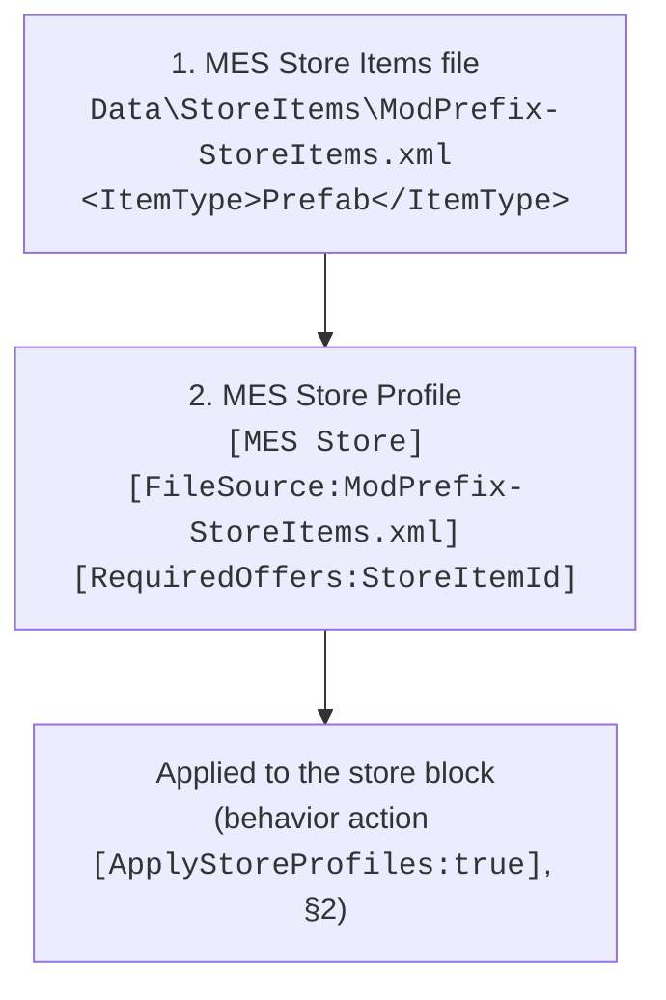
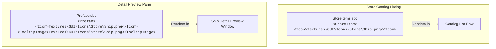

# NPC Economy, Store Blocks & Grid Sales Reference

Comprehensive reference covering Space Engineers economy stores, prefab grid sales, inventory refresh automation, and custom contract generation.

---

## 1. Selling a Prefab Grid from an MES Store

An MES-stocked store needs two parts: an MES store-items XML file and a `[MES Store]` profile applied to the block. `FactionTypes_Economy.sbc` / `GridsForSale` is **not** part of this chain (Part 3).



### Part 1: MES Store Items File (`Data\StoreItems\*.xml`)
**[HARD]** MES reads store items from its own XML format, not from vanilla `StoreItemDefinition`s: `ProfileManager.GetStoreItemContainer()` loads `Data\StoreItems\<FileSource>` from any loaded mod and deserializes a `StoreItemsContainer`. For a grid, `ItemType` is `Prefab` and `ItemSubtypeId` is the prefab SubtypeId.

```xml
<?xml version="1.0"?>
<StoreItemsContainer xmlns:xsd="http://www.w3.org/2001/XMLSchema" xmlns:xsi="http://www.w3.org/2001/XMLSchema-instance">
  <StoreItems>
    <StoreItem>
      <StoreItemId>HeavyCruiser</StoreItemId>
      <ItemType>Prefab</ItemType>
      <ItemSubtypeId>ModPrefix-Prefab-HeavyCruiser</ItemSubtypeId>
      <Offer>
        <CustomPrice>15000000</CustomPrice>
        <MinPriceMultiplier>100</MinPriceMultiplier>
        <MaxPriceMultiplier>100</MaxPriceMultiplier>
      </Offer>
    </StoreItem>
  </StoreItems>
</StoreItemsContainer>
```

- `ItemType` values (`StoreProfileItemTypes`): `Ore`, `Ingot`, `Component`, `Ammo`, `Tool`, `Consumable`, `RandomCraftable`, `RandomItem`, `Oxygen`, `Hydrogen`, `Prefab`, `Seed`, `Item`, `Datapad`, `OxygenContainer`, `GasContainer`, `Gas`.
- `StoreItemId` is the name the `[MES Store]` profile uses in `[Offers:]` / `[RequiredOffers:]` / `[Orders:]` / `[RequiredOrders:]`.
- **[HARD] A prefab is always listed as quantity 1.** `StoreProfile.CreateStoreItem` calls `block.CreateStoreItem(ItemSubtypeId, 1, price, PCU)` for `Prefab`; `MinAmount`/`MaxAmount` are ignored. Each refresh re-lists it.
- **[HARD] Price**: `CustomPrice` if set (> -1), otherwise MES's minimum-value table or `EconomyHelper.CalculatePrefabCost`, then the price multipliers. Set `CustomPrice` for a fixed price.
- `<PCU>` on the item is what the game checks against the buyer's PCU limit (`MyStoreBlock.BuyPrefabInternal`); the world block limits are checked against the real prefab as well.

### Part 2: MES Store Profile (`[MES Store]`)
```xml
<EntityComponent xsi:type="MyObjectBuilder_InventoryComponentDefinition">
  <Id>
    <TypeId>Inventory</TypeId>
    <SubtypeId>ModPrefix-StoreProfile-HeavyCruiser</SubtypeId>
  </Id>
  <Description>
    [MES Store]
    [FileSource:ModPrefix-StoreItems.xml]
    [MinOfferItems:1]
    [MaxOfferItems:1]
    [RequiredOffers:HeavyCruiser]
  </Description>
</EntityComponent>
```

- `[FileSource:]`: File name under `Data\StoreItems\` (Part 1).
- `[Offers:]` / `[Orders:]`: StoreItemIds eligible for random selection; `[RequiredOffers:]` / `[RequiredOrders:]`: always listed.
- `[Min/MaxOfferItems:]`, `[Min/MaxOrderItems:]`: How many items the refresh rolls.
- `[AddedItemsCombineQuantity:]`, `[AddedItemsAveragePrice:]`, `[EqualizeOffersAndOrders:]`.
- There is no `[StoreItems:]` or `[ItemsRequireInventory:]` tag; MES ignores both.

### Part 3: `GridsForSale` Is Not Needed for MES Stores [HARD]
- `<GridsForSale>` in `FactionTypes_Economy.sbc` is read only by Keen's own station store generator (`MyGenericFactionTypeStrategy.GenerateGridOffers`). MES never reads it, and the purchase path (`MyStoreBlock.BuyPrefabInternal`) never checks it. An MES store sells any prefab in its store-items file.
- Add a prefab there only if you want **Keen-generated** economy stations of that faction type to roll it too, at Keen's calculated price. The list element is `<PrefabName>` (`MyObjectBuilder_FactionTypeDefinition`, `[XmlArrayItem("PrefabName")]`); any other element name is silently ignored.

```xml
<GridsForSale>
  <PrefabName>ModPrefix-Prefab-HeavyCruiser</PrefabName>
</GridsForSale>
```

---

## 2. Automated Store Refreshing (Mike Dude's GVK Pattern)

In long-running multiplayer worlds, economy station store inventories become depleted or cluttered. RivalAI actions can dynamically refresh store inventories on a timer:

```xml
<EntityComponent xsi:type="MyObjectBuilder_InventoryComponentDefinition">
  <Id>
    <TypeId>Inventory</TypeId>
    <SubtypeId>GVK-Store-Action-UpdateRoverSales</SubtypeId>
  </Id>
  <Description>
    [MES AI Action]
    [ApplyStoreProfiles:true]
    [ClearStoreContentsFirst:true]
    [StoreBlocks:Store-Rovers]
    [StoreProfiles:GVK-Store-StoreProfile-BasicVehicles]
  </Description>
</EntityComponent>
```

- `[ApplyStoreProfiles:true]`: Pushes fresh store profiles to matching blocks.
- `[ClearStoreContentsFirst:true]`: Flushes old or empty listings.
- `[StoreBlocks:<TerminalName>]`: Targets specific store terminal blocks on the station grid.

---

## 3. Physical Clearance & Icon Requirements

### A. Where a Bought Grid Spawns [HARD]
`MyStoreBlock.BuyPrefabInternal` searches for free space near the store block, sized to the prefab's bounding sphere:
- **In natural gravity** (a store not on a Keen station counts as an Outpost there): `MyRespawnComponentBase.FindPositionAbovePlanet` with an optimal distance of 60 m from the store and up to 30 tries, deploying at 1.05 × the prefab's radius above the ground.
- **In space**: `MyEntities.FindFreePlace` around the store, up to 20 tries.
- No free spot: the purchase fails with `FreePositionNotFound`. Before that, it fails on PCU (`NotEnoughPCU`) or world block limits.
- **[SOFT]** Leave open, flat ground around a planetary store, larger than the biggest grid it sells; a store boxed in by station structure or steep terrain fails intermittently.

### B. Icons & Tooltip Images
- **[SOFT] PNG vs DDS**: DDS textures for prefab store previews frequently fail to load or become corrupted in the client cache. Always use **256x256 PNG** files for `<Icon>` and `<TooltipImage>`.
- **[HARD] Keen Store Icon Bug (Topic 49223)**: Mod-added ships in economy stores have an engine bug where preview icons occasionally fail to render until the client `.sbcB5` cache is regenerated.
### C. Store Icons & Preview Thumbnails

Getting prefab thumbnails to render correctly in economy store blocks requires navigating three specific engine requirements:



1. **The Dual Declaration Requirement (Catalog List vs. Preview Pane)**:
   - **`<StoreItem>` Definition (`StoreItems.sbc`)**: Must include `<Icon>` when the store uses vanilla `StoreItemDefinition`s. MES store-item XML (§1 Part 1) has no icon field, so for MES-stocked grids the prefab's own icons below are what render.
   - **`<Prefab>` Definition (`Prefabs.sbc`)**: Must include **both** `<Icon>` and `<TooltipImage>`.
   - **[HARD] The Missing Preview Bug**: Keen's store block UI queries `<TooltipImage>` when a player clicks a ship to view its stats. If `<TooltipImage>` is omitted from the prefab definition, the preview pane renders completely blank/transparent.

2. **Image Format & Resolution (DDS vs. PNG)**:
   - **Modern Standard (BC7 DDS)**: In modern Space Engineers (DX11), **BC7** is the gold standard for GUI icons and store thumbnails. It provides superior compression quality without the blocky color artifacts of older formats:
     ```bash
     texconv.exe -f BC7_UNORM_SRGB -m 1 -y InputIcon.png -o OutputFolder/
     ```
   - **Legacy Fallback (BC3 / DXT5 DDS)**:
     ```bash
     texconv.exe -f BC3_UNORM -m 1 -srgb -y InputIcon.png -o OutputFolder/
     ```
   - **The #1 DDS Trap: Mipmaps (`-m 1`)**:
     - When saving DDS icons, **never generate a mipmap chain (hard cap to 1 mip level)**.
     - If mipmaps are included, Keen's texture streaming system treats the icon like a 3D model texture. On clients with Texture Quality set to Medium or Low, the game displays a low-resolution mip (e.g. 16x16 or 32x32), turning the store icon into blurry mud.
   - **Dimensions**: Must be **Power of Two (POT)** (256x256 or 512x512) with a 1:1 square aspect ratio. Non-square textures stretch and distort.
   - **Color Space & Alpha**: Always use **sRGB** (prevents washed-out colors) and **straight alpha** (prevents dark fringe halos around edges).
   - **PNG Fallback**: Standard 256x256 32-bit RGBA PNG files work cleanly if you do not want to run a DDS conversion pipeline.

3. **Pathing Syntax**:
   - Must be mod-root relative: e.g. `Textures\GUI\Icons\Store\ModPrefix_HeavyCruiser.png`.
   - **Always use Windows backslashes (`\`)**: Forward slashes (`/`) cause Keen's content loader on Windows dedicated servers to fail file resolution.

4. **The Client `.sbcB5` Binary Cache Trap (Keen Bug Topic 49223)**:
   - Keen precompiles SBC files into binary `.sbcB5` cache files in `%AppData%\SpaceEngineers\Cache\`.
   - When a mod updates an icon path or adds a new store prefab, clients frequently retain stale null references from their cached `.sbcB5` file.
   - **Resolution**: Clients must clear their `.sbcB5` cache, or the mod author must update the mod version/timestamp to force cache regeneration.

---

## 4. Item-Triggered Delivery Contracts on MES Encounters (MES 2.74.03+)

Keen's economy can seed a "data item" (`EncryptedDataStorage`, `InterceptedTransmissions`, `ResearchMaterials`, `SmuggledGoods`, `TechnicalBlueprints`) into an encounter's cargo. A player who picks it up gets a delivery contract to a station. From 2.74.03, MES raises Keen's `MySpawnGroupDefinition.OnSpawnGroupGridsCreated` for its own spawns, so this (and Keen's grid-triggered contracts, if the vanilla `<SpawnGroup>` defines a contract trigger) works on MES encounters.

- **Opt-in per spawn**: `[EnableItemTriggeredContracts:true]` in `[MES Spawn Conditions]` (default `false`). MES forces it `true` for vanilla SpawnGroups it converts (`SpawnGroupManager.cs`, `Context.IsBaseGame`).
- **[HARD] Requirements** (`MySessionComponentItemTriggeredContracts.OnEncounterSpawned`): server side, world setting **Economy enabled**, and at least one `MyCargoContainer` with an inventory on the spawned grids. The item goes into one random cargo container. Grids without cargo containers never get one.
- **[HARD] MES overrides the contract definition**: at load, MES re-initializes **every** `SessionComponentItemTriggeredContractsDefinition` (vanilla and other mods') with its own hardcoded values: `SpawnChance 0.35`, `AllowEnemyFactions true`, the five `Deliver_*` entries above at weight 1. Custom tuning of that definition in another mod has no effect while MES is loaded.
- **Whitelist by SpawnGroup name, per session**: a spawn with the flag adds its SpawnGroup name to the whitelist before the grids are created. The list is not saved, and once a group is on it, any later spawn of that group in the same session qualifies, even through a conditions profile without the flag.
- **2.74.03 bug, fixed in 2.74.04**: the whitelist started empty, which Keen treats as "all SpawnGroups", so every MES spawn could roll a contract item until the first opted-in group spawned (patch note: "the first encounter type that spawned after a load would always contain an item contract"). 2.74.04 seeds it with a dummy entry.
